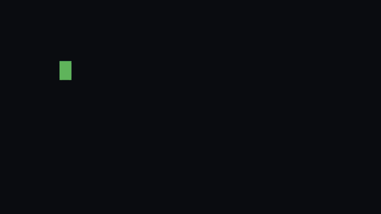

# alejandro.blanco()

[](https://alexxblaro16.github.io/video/portfolio.mp4)

**[Jugar en alexxblaro16.github.io](https://alexxblaro16.github.io)** · [ver el vídeo con sonido](https://alexxblaro16.github.io/video/portfolio.mp4)

Portfolio de **Alejandro Blanco Rodríguez**, desarrollador full stack junior, hecho como un videojuego de pixel art:
creas tu personaje, entras en Villalpando por la Puerta de la Villa y Alejandro te enseña su vida, sus proyectos y su
stack. Para quien tenga prisa hay un **modo clásico**: una web profesional con foto, proyectos, trayectoria, stack y contacto, y el CV y el contacto están siempre a mano.

> `javac HelloWorld.java` → `java AlejandroBlanco` → `Hello, World!`
> Java fue el primer lenguaje que aprendí, así que el juego empieza ahí.

## Qué tiene

- **Intro de terminal**, menú (continuar, nueva partida, modo clásico, opciones y créditos) y **creador de personaje**
  (chico o chica, nombre, piel, doce peinados, color de pelo, barba, ocho prendas, dibujo en el pecho, colores, corte,
  zapatillas, gorra, gorro o cinta, gafas, cascos, mochila, cadena y sonrisa),
  con vista previa animada que se puede girar y un botón de personaje aleatorio. La ropa se cambia jugando (botón «Ropa» o
  el armario de su cuarto).
- **Recorrido guiado**: Alejandro va delante y cuenta cada etapa (Villalpando, el instituto, la residencia en Madrid,
  MEDAC, las prácticas en Anexia, la UDIT, el Erasmus, los hackatones y DANTE P.W.). Se puede saltar en cualquier momento.
- **Mapa de su vida en píxeles**, con sitios dibujados a partir de fotos reales: la Puerta de la Villa (que se cruza
  por el arco), la Plaza Mayor con sus soportales, Reblán y su furgoneta, el IES Tierra de Campos, MEDAC Albalá y la UDIT.
- **Edificios por dentro**: la casa de la familia (su cuarto y el salón), la tienda Reblán, el aula del MEDAC y la UDIT
  (la entrada con sus profes, los tornos y el ascensor a la planta 3, con sus clases).
- **Día y noche**: un ciclo de 6 minutos con ventanas y farolas que se encienden (o un botón para cambiarlo al momento).
- **Personajes que pasean por su zona** y charlan entre ellos: familia y amigos, con su nombre de pila al pasar el ratón.
- **El Monbus**: una autovía separa Villalpando de Madrid; se coge el autobús en la parada del pueblo y, tras el viaje por
  la meseta, te deja en la Estación Sur (Méndez Álvaro).
- **Paneles** de trayectoria, proyectos (con repositorio y demo), trofeos, stack y contacto, y **logros** al visitarlos.
- **Minijuegos**: cuatro recreativas (serpiente, nave, rompe-ladrillos y un laberinto propio), penaltis en el campo
  de fútbol (con tiro relámpago) y Bit Drop, un juego propio de bloques que caen, en la planta 3 de la UDIT.
- **Secretos**: el robot Jerry y DANTE P.W. (andan sueltos y te siguen si se lo pides), un bloque de Minecraft, el código Konami
  y guiños a la programación, a The Office, a Bob Esponja, a Batman, a Spider-Man, a Dragon Ball (siete esferas
  escondidas y una nube que te lleva volando), a Inazuma Eleven y a Mickey Mouse.
- **Español e inglés**, siete estilos de música chiptune (apagada por defecto), pantalla completa y palanca táctil en el
  móvil, y la partida guardada en el navegador.

## Controles

| Acción | Teclado | Móvil |
| --- | --- | --- |
| Moverse | WASD o flechas | palanca (pon el pulgar en la mitad izquierda) |
| Hablar / entrar | E, espacio o Enter | botón A |
| Menús | flechas + Enter o ratón | toque |

## Stack

- **Phaser 3.80** (física arcade, escalado a pantalla completa, `pixelArt`).
- **Vite 5** para el desarrollo y la compilación.
- **JavaScript** sin frameworks para la interfaz (HUD, diálogos, paneles y modo clásico en HTML y CSS).
- **Web Audio** para el sonido. **Press Start 2P** y **VT323** de Google Fonts.

No hay ni una imagen: **todo el pixel art se dibuja con código** en canvas al arrancar (personajes, edificios, suelos y
objetos). Así la web pesa poco y cualquier cambio de color o de diseño es una línea de código.

## Ejecutarlo

```bash
npm install
npm run dev       # http://localhost:5173
npm run build     # genera dist/
npm run preview   # sirve dist/ en http://localhost:4173
```

Para publicarlo en una subcarpeta (por ejemplo, en GitHub Pages de un repositorio de proyecto) se compila con
`BASE=/nombre-del-repo/ npm run build`. El flujo de `.github/workflows/deploy.yml` lo hace solo en cada push a `main`.

## Estructura

```
index.html            HUD, diálogo, paneles, mando táctil y modo clásico (HTML)
src/main.js           arranque de Phaser, espera a la fuente y código Konami
src/scenes/Mundo.js   la escena: mapa, colisiones, cámara, recorrido, NPC e interacción
src/mapa.js           qué hay en el mapa y dónde: edificios, objetos, suelos, personajes y recorrido
src/personajes.js     personajes de 24 × 32 dibujados por partes
src/edificios.js      edificios y objetos grandes (los reales, copiados de fotos)
src/sprites.js        suelos, árboles, Jerry y decorado pequeño
src/pixel.js          utilidades de dibujo: colores, contorno automático y una fuente de 3 × 5
src/pantallas.js      intro, menú, opciones, créditos, creador de personaje y probador
src/viaje.js          la escena del viaje en Monbus entre Villalpando y Madrid
src/ui.js             HUD, diálogos, paneles, logros, etiquetas y modo clásico
src/content.js        textos de la web en español e inglés (proyectos, stack, trayectoria)
src/historia.js       diálogos del recorrido en español e inglés
src/estado.js         idioma, sonido, personaje y progreso (localStorage)
src/sonido.js         efectos y música chiptune con Web Audio
src/arcade.js         los cuatro minijuegos de los recreativos
docs/                 documentación del proyecto
```

## Documentación

- [Arquitectura](docs/ARQUITECTURA.md): cómo está montado el juego por dentro.
- [Pixel art con código](docs/PIXEL_ART.md): cómo se dibujan los personajes y los edificios.
- [Guion](docs/GUION.md): qué cuenta cada parada del recorrido.
- [Evolución](docs/EVOLUCION.md): cómo ha ido cambiando el proyecto y por qué.

## Contacto

- GitHub: [alexxblaro16](https://github.com/alexxblaro16)
- LinkedIn: [Alejandro Blanco Rodríguez](https://www.linkedin.com/in/alejandro-blanco-rodr%C3%ADguez-13977530b/)
- Correo: alexxblaro@gmail.com
- El CV en español y en inglés está en `public/cv/` y se descarga desde la propia web.

Diseñado y programado por Alejandro Blanco Rodríguez.
